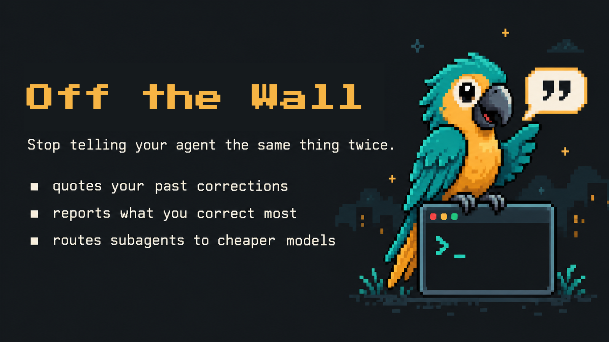
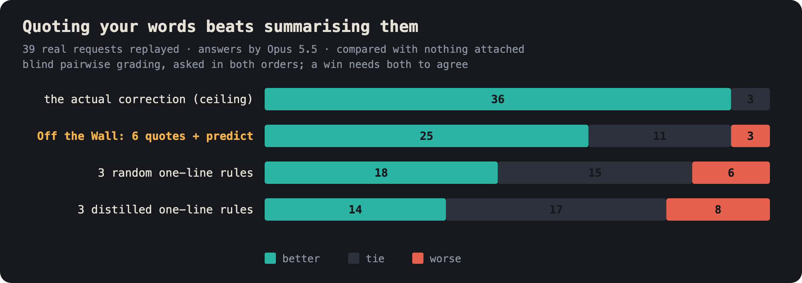
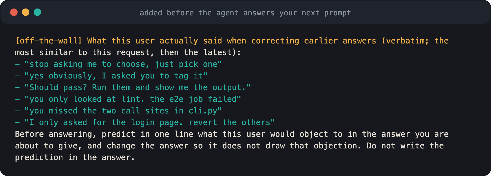
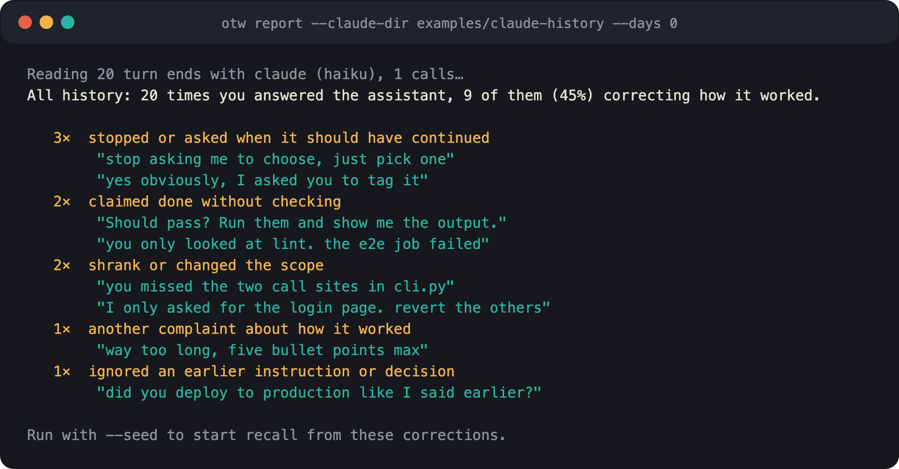
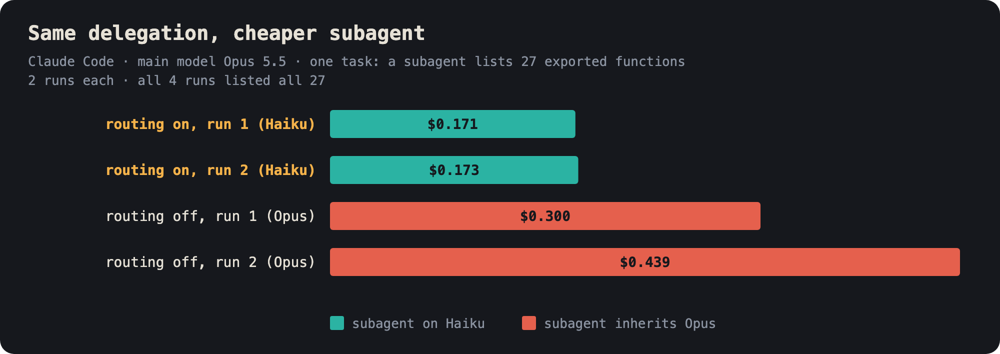

"묻지 말고 골라서 해." "테스트 진짜 돌려 본 거 맞아?"

Claude Code와 Codex를 매일 쓰다 보니, 같은 지적을 몇 번이고 반복하고 있었습니다. 세어 보기로 했습니다. 제 대화
기록 6,752건, 제가 직접 쓴 메시지 4,990개를 읽어 보니 **"요청한 범위를 다 하지 않았다"는 지적만 174번, "확인도
안 하고 됐다고 했다"는 지적이 63번**이었습니다. 지적한 세션 안에서는 고쳐지지만, 다음 세션이 되면 처음부터 다시입니다.

그래서 **내가 했던 지적을 내 말 그대로, 다음 답 앞에 놓아 주는 도구**를 만들었습니다.
[Off the Wall](https://github.com/toranalytics/off-the-wall)입니다. 이 글은 왜 이렇게 만들었는지, 정말 효과가
있는지 어떻게 쟀는지, 그리고 아직 모르는 것은 무엇인지에 대한 기록입니다.

```toc
```

## 1. 문제: 규칙은 쌓이는데 행동은 그대로다

지적을 기억시키는 가장 흔한 방법은 규칙 파일(`CLAUDE.md`, `AGENTS.md`)입니다. 지적을 모아 "항상 테스트를 실행할
것" 같은 한 줄 규칙으로 요약해 두죠. 지적을 자동으로 규칙으로 바꿔 주는 도구들도 있습니다.

저도 그렇게 했습니다. 그런데 규칙이 늘어나도 같은 지적은 계속 나왔습니다. 그래서 질문을 바꿨습니다.
**요약된 규칙이 정말 답을 바꾸는가? 아니면 다른 형태가 더 나은가?**

## 2. 실험: 요약 대 인용

### 어떻게 쟀나

- **요청 39개**: 제 기록에서, 실제로 바로 다음에 제가 지적을 했던 요청만 골랐습니다. 그리고 그 지적이 글만 보고도
  맞는지 판단할 수 있는 경우로 제한했습니다(예: "범위를 줄였다", "확인 없이 완료라고 했다").
- **조건 4가지**: 같은 요청에 아래 중 하나를 붙여서 Opus 5.5가 다시 답하게 했습니다.
  1. 그때 실제로 했던 지적 (정답을 알려 주는 셈이라 상한선)
  2. 과거 지적 원문 6개 + "이 사용자가 뭐라고 지적할지 예측하고 피하라"는 지시 (**Off the Wall 방식**)
  3. 무작위로 고른 한 줄 규칙 3개
  4. 과거 지적을 요약한 한 줄 규칙 3개
- **채점**: Sonnet이 어느 조건의 답인지 모르는 상태에서 두 답 중 나은 쪽을 고릅니다. 순서 효과를 없애려고 A/B 순서를
  바꿔 두 번 물었고, **두 번 모두 같은 쪽을 골랐을 때만 승리**로 셌습니다. 기준은 아무것도 붙이지 않은 답입니다.

### 결과



| 붙인 것 | 승 | 무 | 패 |
| :-- | --: | --: | --: |
| 실제 지적 (상한선) | 36 | 3 | 0 |
| **과거 지적 원문 6개 + 지적 예측** | **25** | **11** | **3** |
| 무작위 한 줄 규칙 3개 | 18 | 15 | 6 |
| 요약한 한 줄 규칙 3개 | 14 | 17 | 8 |

두 가지가 눈에 띕니다.

1. **요약한 규칙은 아무 규칙이나 붙인 것보다 나을 게 없었습니다.** 공들여 요약한 규칙이 무작위 규칙에 졌습니다.
2. **원문 인용은 무작위 규칙을 이겼습니다.** 인용과 무작위 규칙을 직접 맞붙이면 17승 14무 8패입니다.

제 해석은 이렇습니다. "범위를 다 해라"라는 규칙은 맞는 말이지만, 모델이 **지금 이 요청이 그 규칙에 해당하는지**
알기 어렵습니다. 반면 "지금 루트 디렉토리와 옵시디언만 하라고" 같은 원문에는 상황과 말투가 같이 남아 있어서, 모델이 비슷한
상황을 알아봅니다. 요약하는 순간 그 단서가 사라집니다.

## 3. 어떻게 동작하나

### 에이전트가 실제로 보는 것

질문을 보낼 때마다, 에이전트가 답하기 전에 아래 블록이 붙습니다. 저장된 지적 중 **이번 요청과 가장 비슷한 3개,
그리고 가장 최근 것**을 합쳐 최대 6개를 원문 그대로 보여 주고, 지적을 예측하게 합니다.



| 시점 | 하는 일 |
| :-- | :-- |
| 질문을 보낼 때 | 과거 지적 최대 6개를 원문 그대로 붙임 (비슷한 것 3개 → 최근 것) |
| 질문을 보낼 때 | 직전 답과 새 메시지를 **별도 프로세스**에서 판정해, 지적이면 저장 |
| 답이 끝날 때 | 판정에 쓰도록 답의 끝부분을 보관 |
| 하위 에이전트 호출 | 모델을 지정하지 않은 호출을 한 번 돌려보냄 (아래 4절) |

설계하면서 지킨 원칙은 세 가지입니다.

- **아무것도 기다리지 않는다.** 판정은 질문이 이미 전송된 뒤 따로 돕니다. 사용 경험에 지연이 없습니다.
- **API 키가 필요 없다.** 판정은 이미 쓰고 있는 `claude`/`codex` CLI로 돌립니다. 이미 내고 있는 구독 안에서 끝납니다.
- **내 컴퓨터 밖으로 나가지 않는다.** 모든 기록은 `~/.otw`에만 있습니다. 지우면 다 잊습니다.

### 판정기는 얼마나 정확한가

지적을 놓치면 인용할 것이 없고, 지적이 아닌 것을 저장하면 엉뚱한 말을 인용하게 됩니다. 그래서 판정기도 쟀습니다.
사람이 표시한 56개 턴에서 Claude Haiku 판정기의 **정밀도는 0.82, 재현율은 0.72**였습니다. 대략 지적 4개 중 3개를
잡고, 잡은 것의 5분의 4가 실제 지적이라는 뜻입니다.

처음 설치할 때 쓰는 `report` 명령은 20턴씩 묶어서 판정합니다. 묶음 판정이 한 턴씩 판정한 결과와 얼마나 같은지
100개 턴(지적 50, 아닌 것 50)으로 모델마다 두 번씩 쟀습니다.

| 판정 모델 | 한 턴씩 판정과 일치 (2회) | 두 번 결과 겹침 |
| :-- | --: | --: |
| Claude Haiku | 84, 90 | 0.83 |
| Claude Sonnet | 81, 71 | 0.60 |
| gpt-6.1-sol | 88, 88 | 0.92 |
| gpt-6-luna | 61, 56 | 0.38 |

더 큰 모델이 늘 나은 것은 아니었습니다(Sonnet < Haiku). 그래서 기본 판정기를 Claude는 Haiku, Codex는 sol로
정했습니다.

### 설치 첫 1분: 내가 뭘 가장 많이 지적하나

설치하면 바로 인용이 시작되지는 않습니다. 저장된 지적이 없으니까요. 그래서 `report` 명령이 이미 내 컴퓨터에 있는
Claude Code·Codex 기록을 읽어, 내가 무엇을 가장 많이 지적했는지 보여 줍니다. 아래는 저장소에 들어 있는 예시 기록에
돌린 실제 출력입니다.



`--seed`를 붙이면 찾은 지적을 저장해서, **다음 질문부터 바로** 인용이 시작됩니다. 몇 주씩 쌓일 때까지 기다릴 필요가
없습니다.

## 4. 덤: 하위 에이전트를 싼 모델로

메인 에이전트가 하위 에이전트를 부를 때 모델을 지정하지 않으면, 파일 찾기나 grep 같은 단순한 일도 가장 비싼 모델로
돕니다. Off the Wall은 메인 모델이 **맡기는 일이 무엇을 결정하게 하는지**에 따라 모델을 고르게 합니다.

| 등급 | 언제 | Claude Code | Codex |
| :-- | :-- | :-- | :-- |
| small | 찾기·grep·목록·추출·형식 변환 | `haiku` | 빠른 모델, `low` |
| mid | 목표와 기준이 정해진 조사·리뷰·구현·테스트 | `sonnet` | 주력 모델, `medium` |
| large | 무엇이 문제인지부터 정해야 하는 일 (근본 원인, 설계) | `opus` | 최상위 모델, `high` |

따로 떼어 둔 실제 위임 30건에서, 이 규칙을 따른 Opus는 사람이 정한 모델을 **28번** 골랐고 더 약한 모델을 고른 적은
없었습니다. 비용은 같은 위임 작업 하나를 조건마다 두 번 돌려 비교했습니다.



규칙을 켠 쪽은 $0.171과 $0.173, 끈 쪽은 $0.300과 $0.439였고 결과는 네 번 모두 같았습니다(27개 함수 모두 찾음).
작업 하나, 두 번씩이라 평균이 아니라 참고용입니다.

## 5. 아직 모르는 것

솔직하게 적어 둡니다.

- **표본이 한 사람입니다.** 모든 숫자는 제 기록에서 나왔습니다. 일반 법칙이 아니라 첫 결과입니다.
- **판정기는 지적의 4분의 1 정도를 놓칩니다.** 재현율 0.72입니다.
- **Codex 모델 대응은 측정하지 않았습니다.** Claude의 세 등급을 유추로 맞춘 것입니다.
- **Windows에서는 실제 세션을 돌려 보지 않았습니다.** 테스트와 훅 실행 확인만 CI에서 통과했습니다.
- **인용은 모델에게만 보입니다.** 세션 중에 사용자 화면에는 나오지 않습니다.

## 6. 써 보기

Claude Code:

```
/plugin install off-the-wall --marketplace toranalytics/off-the-wall
```

Codex:

```bash
codex plugin marketplace add toranalytics/off-the-wall
codex plugin add off-the-wall@off-the-wall
```

Codex에서는 `/hooks`를 한 번 열어 훅을 승인해야 동작합니다. 그다음 내 기록으로 시작합니다(Node 18 이상).

```bash
git clone https://github.com/toranalytics/off-the-wall && cd off-the-wall
node bin/otw.mjs report --seed
```

가장 궁금한 것은 **여러분의 기록에서도 같은 결과가 나오는지**입니다. `report` 결과나 써 본 느낌을
[이슈](https://github.com/toranalytics/off-the-wall/issues)로 남겨 주시면 정말 반갑겠습니다. 도움이 됐다면
[GitHub 저장소](https://github.com/toranalytics/off-the-wall)에 ⭐ 하나 부탁드립니다.
