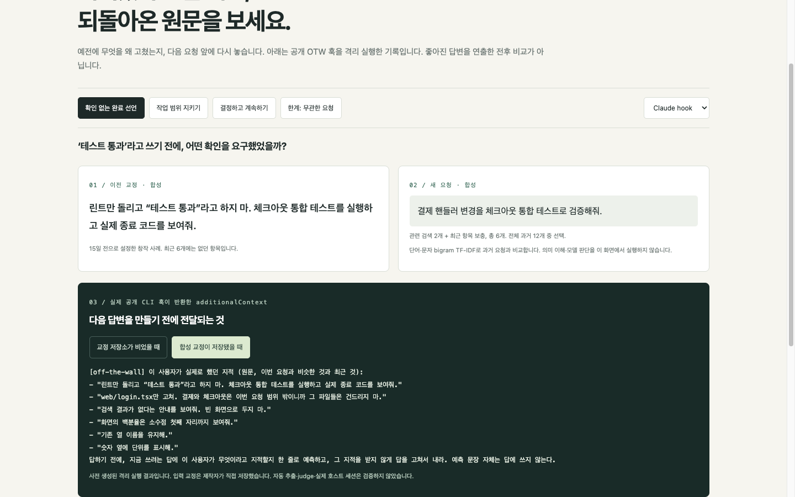

> 2026-10-28 업데이트. 모델이 알 수 없는 개인 선호에서 효과가 처음으로 측정됐습니다(아래 7장). 합성 시험이라 실제 기록에서의 효과는 아직 모릅니다.
> 2026-10-27 업데이트. 입력 경계 수정이 공개판(0.2.0)에 반영됐고, 0.2.1 후보(설정 오류 시 캡처 차단, 삭제 후 저장 방지, `otw status`의 훅 점검)가 병합됐습니다. Codex 실제 호스트에서 한 번 돌려 본 기록과 프롬프트 길이 측정을 추가했습니다. Claude Code는 실제 호스트에서 확인하지 못했습니다.
> 2026-10-23 업데이트. 과거 실험, 공개 코드의 재현 범위, 아직 확인하지 못한 사용자 효과를 구분했습니다.

코딩 에이전트를 고칠 때 중요한 것은 “다음부터 잘해”라는 규칙만이 아니었습니다. **어떤 요청에서 무엇을 어떻게 고쳐 달랬는지**가 다음 작업 앞에도 남아 있어야 했습니다.

[Off the Wall](https://github.com/toranalytics/off-the-wall)은 Claude Code와 Codex에 저장된 과거 정정 원문을 다음 요청의 컨텍스트로 인용하는 초기 플러그인입니다. 더 나은 답변이나 비용 절감을 보장하는 도구는 아닙니다.

**[개인 기록 없이 원문 회수 데모 보기](/otw-recall-lab.html)**

데모는 설치나 로그인 없이 열립니다. 모든 입력은 만든 사례이며, 공개 훅이 실제로 반환한 컨텍스트와 빈 저장소의 차이를 보여줍니다. 좋아진 모델 답변을 꾸민 전후 비교가 아닙니다.

```toc
```

## 1. 먼저 원문이 돌아오는 순간부터

다음은 개인 대화에서 가져온 인용이 아니라 **데모용 창작 사례**입니다.

> 린트만 돌리고 “테스트 통과”라고 하지 마. 체크아웃 통합 테스트를 실행하고 실제 종료 코드를 보여줘.

나중에 “결제 핸들러 변경을 체크아웃 통합 테스트로 검증해줘”라는 새 요청을 보냅니다. “검증을 잘하라”라는 일반 문구 대신, **어떤 테스트와 어떤 증거를 요구했는지**가 원문으로 컨텍스트에 돌아옵니다.



*합성 입력의 격리 실행 화면입니다. 모델의 다음 답변은 실행하지 않았습니다. 다른 작업의 범위 지적도 섞이는 한계가 있으며, 아래에서 설명합니다.*

데모에는 작업 범위를 지키는 사례, 선택을 위임받았을 때 다시 묻지 않는 사례, 그리고 무관한 요청에도 최근 교정이 들어오는 한계 사례가 있습니다. 핵심 세 사례의 정정은 최근 6개보다 오래된 항목입니다.

## 2. 이번에 실제로 검증한 범위

공개 OTW 0.1.1의 고정 커밋 `07fe3d3d4f4accc153eb0684f506e0d3c206fdcc`를 수정하지 않고 실행했습니다.

- 합성 요청 4개 × 빈/저장 상태 × Claude/Codex 훅 모드 = CLI 훅 실행 16회입니다.
- 저장된 교정과 요청은 제작자가 직접 만든 fixture입니다. 자동 판정이나 과거 기록에서의 추출을 검증한 것이 아닙니다.
- 관련·최근 교정이 선택되어 `additionalContext`에 들어가는지, 미래 시점의 교정이 제외되는지 확인했습니다.
- 개인 기록, 모델 제공자, 실제 Claude Code/Codex 호스트 세션은 사용하지 않았습니다.

**회수됨 → 모델이 따름 → 실제 작업이 성공함 → 사용자가 덜 고침**은 서로 다른 단계입니다. 이번 재현은 첫 번째까지만 확인했습니다.

### 2-1. 실제 Codex에서 한 번 돌려 본 기록 (10월 27일 추가)

위 재현은 호스트 없이 훅만 실행한 것이었습니다. 그래서 macOS의 실제 Codex(codex-cli 0.162.1)에서 플러그인 0.2.0을 격리된 홈 디렉터리와 합성 프롬프트로 한 번 돌렸습니다. 플러그인 설치, 훅 신뢰, 한 턴의 교정 저장, 다음 턴에 그 교정이 개발자 메시지로 주입되는 것, 번들 예시 기록에 대한 `otw report`(20개 답변 중 9개 분류)를 확인했습니다. 기록은 [저장소 docs](https://github.com/toranalytics/off-the-wall/blob/main/docs/live-codex-smoke-2026-10-27.md)에 있습니다.

- **훅 신뢰 전에는 훅이 돌지 않습니다.** 설치만 하면 조용히 아무 일도 일어나지 않습니다. `/hooks`에서 신뢰해야 하고, 0.2.1부터 `otw status`가 최근 훅 활동과 신뢰된 항목 수를 보여 줍니다.
- 한 대의 컴퓨터에서 한 번 돌린 것입니다. 모델이 회수된 교정을 따랐는지는 보지 않았습니다.
- **Claude Code는 실제 호스트에서 돌려 보지 못했습니다.** 이번 시험 환경에서는 로그인된 Claude Code를 쓸 수 없었습니다. 목록 등재 PR에도 실험적 연동이라고 적었습니다.

## 3. 현재 공개판이 하는 일

질문을 보낼 때 저장된 교정 중 과거 요청과 문자열 특징이 비슷한 항목 최대 3개를 먼저 고르고, 최근 항목을 보충해 최대 6개를 인용합니다. 검색은 단어·문자 bigram 기반 TF-IDF이며, 의미 이해나 적용 범위의 정확한 판단을 보장하지 않습니다.

판정 기능을 켜면 직전 답변과 새 메시지를 별도 프로세스에서 검토해 교정 후보를 저장합니다. `report`는 기존 대화 기록에서 교정을 분류하는 선택적 진단 기능입니다. 모델 선택 지침도 포함하지만, 이를 자동 최적화나 일반적인 비용 절감으로 소개하지 않습니다.

인용 블록은 사용자의 대화창에 표시되는 카드가 아니라 **모델에게 전달되는 추가 컨텍스트**입니다. 이 글의 데모는 그 숨은 입력을 살펴보는 별도의 검사 화면입니다.

## 4. 원문을 보존하는 것만으로 충분하지 않다

데모의 결제 테스트 요청에는 “로그인 파일만 고쳐라”는 다른 작업의 일회성 범위 교정도 함께 선택됐습니다. 무관한 화성 질문에서도 최근 교정 6개가 들어옵니다.

핵심 문장이 들어왔다는 사실만으로 선택 전체가 적절하다고 할 수 없습니다. 원문의 “이번 요청”이 과거 작업을 가리키는지, 지금도 유지해야 할 선호인지 구분해야 합니다. 모델이 실제로 이 때문에 잘못 행동했다는 결과는 아직 측정하지 않았습니다.

제품의 다음 검토 과제는 지속적인 선호와 일회성 작업 지시 구분, 원래 요청·프로젝트·적용 범위의 출처 표시, 무관한 최근 항목 처리입니다. **아직 공개 기능으로 구현됐다는 뜻은 아닙니다.**

또한 사용자 역할의 자동 플러그인 메시지가 사람 교정처럼 분류될 수 있는 입력 경계 문제를 확인했고, 출처 태그와 작업 디렉터리 기준 회수를 넣은 수정이 0.2.0으로 공개됐습니다. 그래도 자동 입력을 완전히 가려낸다고 보장할 수는 없습니다. 이전에 제가 SNS에 올렸던 개인 기록 집계(수천 건 중 가장 많은 교정 횟수, 비율 등)는 이 문제가 섞였을 수 있어서 철회했고, 다시 확인하기 전에는 사용하지 않습니다.

## 5. 과거 실험은 어디까지 말해 주나

과거에는 한 사람의 기록에서 선택한 39개 요청을 도구 없이 텍스트로 재생하고 모델 채점기를 사용한 탐색 실험을 보고했습니다. 원문 6개와 지적 예측 지시를 함께 붙인 조건은 무첨부 대비 25승·11무·3패로 집계됐습니다.

하지만 무작위 규칙과 직접 비교한 17승·14무·8패는 확정적인 우위의 근거가 아닙니다(보고된 양측 검정 p≈0.11). 원문 형식과 예측 지시도 분리하지 않았으므로 원문 하나의 인과효과라고 할 수 없습니다.

보존된 과거 실행 로그에서 집계와 조건을 확인했지만, 원본 case별 산출물을 독립 재실행한 것은 아닙니다. 실행·사실 확인형 업무 대부분은 이런 텍스트 재생으로 평가할 수 없습니다. **현재 공개 버전의 실제 작업 성공률, 장기 유지, 평균 비용 절감은 별도 검증이 필요합니다.**

## 6. 데이터와 비용

저장된 결과와 세션 상태의 기본 위치는 로컬 `~/.otw`입니다. 다만 판정과 개인 리포트 분석은 사용자가 쓰는 Claude/Codex CLI를 통해 **대화 발췌문을 해당 모델 제공자로 전송**합니다. “아무 데이터도 컴퓨터 밖으로 나가지 않는다”는 설명은 맞지 않습니다.

별도 API 키가 필요 없더라도 제공자 호출은 플랜 한도·사용량·요금을 소모할 수 있습니다.

회수 블록이 프롬프트를 얼마나 늘리는지도 한 번 재 봤습니다(Codex 0.162.1, 합성 교정 6개, `codex exec resume`의 두 번째 턴). 회수 기능을 끄면 입력 13,743토큰, 회수만 켜면 14,028(+285), 서브에이전트 모델 선택 안내만 켜면 14,364(+621), 둘 다 켜면 14,781(+1,038)이었습니다. 조건당 한 번씩이라 참고용입니다. 재개한 세션에서 모델 선택 안내가 두 번 주입되는 것도 관찰했고, 이 중복은 조사해야 합니다. 이 측정은 프롬프트 크기만 본 것이고 답변 품질이나 비용 절감을 뜻하지 않습니다. 기록: [측정 메모](https://github.com/toranalytics/off-the-wall/blob/main/docs/token-overhead-2026-10-27.md). 판정은 분리된 프로세스로 실행되지만, 전체 사용 경험에 지연이 없다고 보장하지 않습니다. 저장소 삭제와 제공자 측 데이터 처리는 별개입니다.

## 7. 10월 28일 측정: 모델이 모르던 내 습관을 따르는가

앞선 시험은 모델이 원래 잘 하는 실수(테스트 돌리기, 끝까지 하기)를 골라서 켜도 꺼도 만점이었습니다. OTW가 쓸모 있어야 하는 곳은 그게 아니라 **모델이 알 수 없는 개인 습관**입니다. 커밋 형식, 쓰는 패키지 도구, 말투, 날짜 형식 같은 것들이요.

그래서 이런 선호 11개를 작업으로 만들어 각각 3번씩 33번 시켰습니다. 작업과 채점기는 실험자가 아닌 다른 모델이 썼고 모두 자동 채점입니다. 계획은 실행 전에 고정했습니다.

| 조건 | 습관을 지킨 횟수 |
|---|---|
| OTW 없음 | 1/33 |
| OTW 기본 | 9/33 |
| OTW 넓게 찾기 옵션(`recallWide`) | 17/33 |

- 저장소를 바꿔 다시 했는데 같은 크기의 격차가 나왔습니다(16/33 대 8/33, 17/33 대 9/33).
- 원인은 검색입니다. 맞는 과거 지적이 인용에 들어오면 모델이 훨씬 자주 따르고, 못 찾으면 달라지는 게 없습니다. 넓게 찾기 옵션이 더 자주 찾습니다.
- 한계도 분명합니다. 작업 11개 중 2개는 인용이 보여도 모든 조건에서 0/3이었습니다. 모델이 원래 잘 하는 실수에서는 이점을 못 찾았고(16개 중 14개 작업), 규칙 150줄을 그냥 넣은 쪽이 전체로는 더 높았습니다. 다만 기록이 길어지면 규칙 전체를 넣는 방식은 못 씁니다.
- 아직 모르는 것: 실제 사용자의 긴 기록, 다른 모델, 대화형 사용, 장기 효과. 이 지적들은 모델이 쓴 합성 기록입니다. 넓게 찾기 옵션은 모든 요청에 인용 6개를 붙이는 부작용 검사가 끝나기 전이라 기본값은 꺼져 있습니다.

실험 기록, 계획, 스크립트, 독립 검토에서 나온 약점까지 [저장소 docs](https://github.com/toranalytics/off-the-wall/tree/main/docs)에 있습니다.

## 8. 써 보기 전에

먼저 [합성 원문 회수 데모](/otw-recall-lab.html)를 보세요. 실제 개인 기록 분석과 회상 저장은 별도 선택입니다. 입력 경계 수정은 공개됐지만 실제 사용으로 충분히 검증되지는 않았으므로, 이 글은 개인 기록에 대한 `report --seed` 실행을 아직 권하지 않습니다.

설치·설정 정보는 [현재 README](https://github.com/toranalytics/off-the-wall)를 확인하세요. Codex는 `/hooks`에서 훅을 신뢰하는 단계가 필요하고, 하지 않으면 훅이 조용히 돌지 않습니다(`otw status`로 확인할 수 있습니다). Windows는 CI의 테스트·훅 실행과 실제 호스트 세션의 성공을 구분해야 합니다.

가장 필요한 피드백은 성공담만이 아닙니다. **관련 없는 교정이 돌아왔는지, 필요한 교정이 빠졌는지, 회수된 뒤에도 같은 실수를 했는지**를 알고 싶습니다. 원문·코드·회사명 없이 [이슈](https://github.com/toranalytics/off-the-wall/issues)로 알려주셔도 됩니다. 개인 기록이나 리포트 원문 제출을 요구하지 않습니다.
